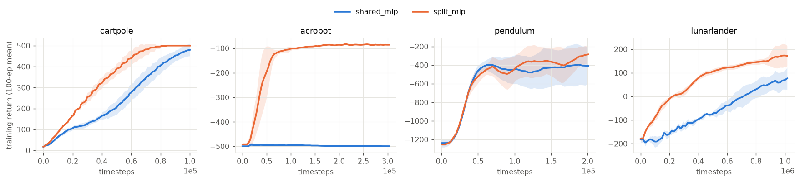
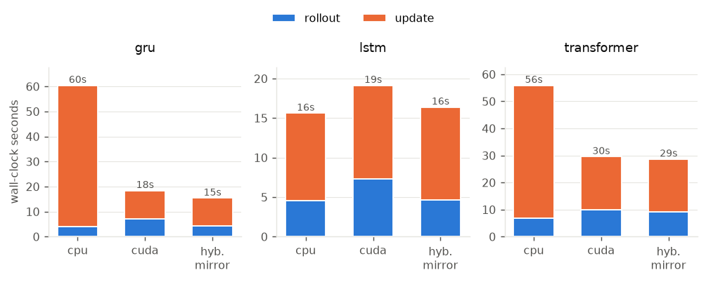
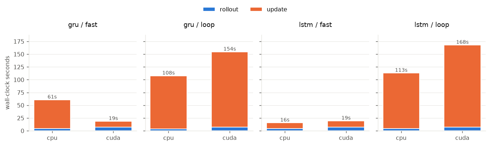
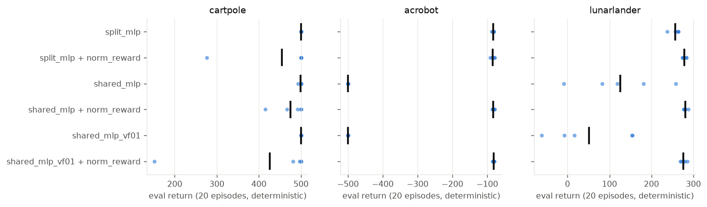
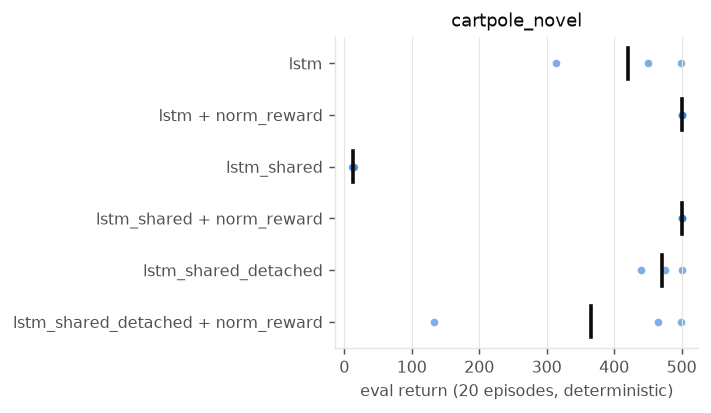

# Findings

Hardware: GTX 1080 (Pascal, 8 GB), 16-core CPU, PyTorch 2.14 (cu126), SB3 / sb3-contrib 2.9.
Background and experimental design: [background.md](background.md). Generated tables and figures
(regenerate with `scripts/aggregate.py`): [results/](results/).

**Caveats.** Seeds are few (3–5), budgets are rl-zoo-sized rather than tuned per architecture, and
"final eval" is 20 deterministic episodes. Treat differences inside one standard deviation as noise.
The timing experiments (E3) are single runs. I didn't measure run-to-run timing noise, so only the
large effects (2–15×) should be read as conclusive; gaps of a few percent (for example `move` vs `mirror`)
are not.

## TL;DR

1. **Shared vs split comes down to the scale of the returns.** With raw rewards, a shared MLP trunk was
   never better than split. It was slightly slower on CartPole, much worse on LunarLander, and
   **failed completely on Acrobot (−500 on every seed)**. The cause is the value loss: large returns
   saturate the shared tanh units (84 % saturated). With **reward normalisation, shared matches split
   with half the parameters** (Acrobot −82.5, LunarLander 281). Down-weighting `vf_coef` 5× does not
   fix it. See [E4](#e4-why-do-shared-parameters-fail).
2. **Memory.** On CartPole-NoVel a plain 8-frame stack (MLP or transformer) solves the task every time,
   more reliably than LSTM/GRU within 200k steps. On Pendulum-NoVel the RNNs (GRU −234, LSTM −255) beat
   the frame stack (−326). The transformer collapsed mid-training, and lowering its lr to 3e-4 only
   partly fixed that. **Truly shared RNNs collapse on CartPole-NoVel** (13 and 46, worse than no
   memory), while sb3-contrib's *detached* sharing works (472). As with MLPs, reward normalisation
   fixes the shared RNNs (500).
3. **GPU vs CPU.** For rl-zoo-sized MLPs (64×64, batch 64) the **CPU is fastest**. The GPU pays roughly 16 s
   of kernel-launch overhead per 100k LunarLander steps whatever the width, and rollouts are slower too.
   The GPU wins in the update phase once networks are wide (256+) *and* minibatches are large (1024),
   or networks are very wide (1024): 5–15× faster updates.
4. **Hybrid CPU rollouts + GPU updates works through a callback**, and transfer costs are negligible
   (about 1 ms per iteration). It's the best option when the *update* is GPU-friendly but the *policy* is
   cheap enough that CPU inference beats the per-step host↔device round trip. Examples: 256-wide MLP with
   large batches, GRUs (4× faster than all-CPU) and transformers (2× faster). For very wide networks (1024)
   pure CUDA edges ahead, because CPU inference itself gets expensive.
5. **Two free speed-ups for recurrent PPO:** (a) the fast sequence path in this repo makes LSTM/GRU
   updates **10–13× faster** than sb3-contrib's per-timestep loop, with identical outputs. (b) On CPU, use
   LSTM, not GRU: PyTorch's CPU LSTM has a fused oneDNN kernel (5× faster) and the GRU doesn't.

---

## E1: Shared trunk vs split actor-critic (MLP)

| env         | model      | final eval     | mean train return (AUC) | params |
|:------------|:-----------|:---------------|:------------------------|-------:|
| cartpole    | shared_mlp | 498.6 ± 3.1    | 239.3 ± 18.5            |  4,675 |
| cartpole    | split_mlp  | 500.0 ± 0.0    | 339.2 ± 14.5            |  9,155 |
| acrobot     | shared_mlp | −500.0 ± 0.0   | −497.6 ± 0.6            |  4,868 |
| acrobot     | split_mlp  | −83.0 ± 2.7    | −143.2 ± 16.2           |  9,476 |
| pendulum    | shared_mlp | −323.2 ± 170.7 | −562.2 ± 128.8          |  4,610 |
| pendulum    | split_mlp  | −223.8 ± 100.1 | −537.3 ± 92.3           |  9,026 |
| lunarlander | shared_mlp | 126.0 ± 100.5  | −62.9 ± 15.7            |  5,061 |
| lunarlander | split_mlp  | 257.2 ± 11.2   | 67.8 ± 13.0             |  9,797 |

5 seeds; full table in [results/e1_shared_vs_split.md](results/e1_shared_vs_split.md).

* Split is better or equal everywhere. The gap tracks how large and unnormalised the returns are:
  * **Acrobot**: reward −1 per step for up to 500 steps, γ=0.99, so values are about −60 to −100. Shared
    never escapes −500.
  * **LunarLander**: returns are in the hundreds. Shared reaches about half the score, with high seed
    variance.
  * **CartPole**: values up to about 50 with γ=0.98. Shared gets there, but more slowly.
  * **Pendulum**: rewards are normalised (`VecNormalize`). The two are nearly indistinguishable during
    learning.
* The shared model has about half the parameters. That can't explain the Acrobot collapse: split
  64×64 nets are far from capacity-limited on these tasks, and the shared trunk has the same width.

## E2: Memory architectures on velocity-masked tasks

| model                | CartPole-NoVel eval | Pendulum-NoVel eval | params  |
|:---------------------|:--------------------|:--------------------|--------:|
| split_mlp (no memory)| 42.7 ± 1.0          | −951.4 ± 104.9      |   8.9k  |
| framestack_mlp (8)   | **500.0 ± 0.0**     | −326.1 ± 194.0      |  10.7k  |
| transformer (8)      | **500.0 ± 0.0**     | −854.7 ± 10.6       | 144.1k  |
| lstm                 | 421.0 ± 95.9        | −255.1 ± 132.1      |  43.3k  |
| gru                  | 407.0 ± 156.9       | **−234.4 ± 88.3**   |  34.6k  |
| lstm_shared          | 12.9 ± 1.4          | −281.3 ± 95.4       |  25.9k  |
| lstm_shared_detached | 471.7 ± 30.0        | −375.0 ± 33.3       |  25.9k  |
| gru_shared           | 45.6 ± 5.4          | −240.8 ± 23.8       |  21.6k  |

3 seeds; full table with AUC and wall-clock in [results/e2_memory.md](results/e2_memory.md).

* **The masking works:** the memoryless MLP fails both tasks.
* **Frame stacking is a strong baseline.** Velocity is a finite difference of two frames, so an 8-frame
  window holds all the missing information. On CartPole-NoVel it learns fastest and most reliably. RNNs
  must *learn* to integrate, so they lag at a 200k budget, but are still improving (see the curves).
* **Pendulum-NoVel favours RNNs.** GRU and LSTM end at about −240, against −326 for the frame stack,
  which also has one bad seed. The RNNs learn more slowly but more stably.
* **The transformer is unstable on Pendulum.** It learns up to about −500, then collapses (the curve
  above). It shares Pendulum's lr=1e-3 with every other model, which is high for attention layers.
  The [lr follow-up](#transformer-learning-rate-follow-up) shows that's only part of the cause. It's
  also 13× larger and 3× slower in wall-clock.
* **Shared vs split RNNs mirror E1.** With *unnormalised* CartPole rewards, letting the value loss
  train the shared RNN destroys learning (13 and 46). Detaching it (sb3-contrib's default `shared_lstm`)
  works as well as separate RNNs. With *normalised* Pendulum rewards, the truly shared LSTM/GRU are fine
  and beat the detached LSTM (−281 vs −375), so the value gradient helps when its scale is reasonable.
  E4 confirms this: with reward normalisation, the truly shared LSTM solves CartPole-NoVel (500).

## E3: CPU vs GPU vs hybrid

### E3a: MLP width × minibatch size (LunarLander, 16 envs, 100k steps, 4 threads)

Total wall-clock seconds (rollout + update):

| network / batch | cpu   | cuda     | hybrid_move | hybrid_mirror |
|:----------------|------:|---------:|------------:|--------------:|
| 64×64 / 64      | **25**| 33       | 33          | 33            |
| 64×64 / 1024    | 15    | 16       | **14**      | **14**        |
| 256×256 / 64    | **29**| 31       | 32          | 31            |
| 256×256 / 1024  | 19    | 16       | 15          | **15**        |
| 1024×1024 / 64  | 117   | **36**   | 38          | 38            |
| 1024×1024 / 1024| 52    | **17.5** | 19.5        | 19.6          |

* **Update phase**:
  * At batch 64 the GPU update costs about 16.6 s whether the net is 64 or 256 wide: so it is
    bound by per-minibatch overhead (kernel launches, Python), not by arithmetic. CPU: 11 s and 14 s.
  * At batch 1024 the GPU is 4× faster than CPU at width 256, and 15× faster at width 1024.
* **Rollout phase**: dominated by stepping the environment (Box2D, about 13 s). Running the
  policy on the GPU *adds* 1–2.5 s for small nets (a host→device→host round trip every step) and
  only *saves* time at width 1024, where CPU inference becomes the bottleneck.
* **Hybrid = CPU rollout + GPU update**, which is best when both halves favour their device. Transfer
  cost is tiny: ≤ 0.1 s per 100k steps for LunarLander, and about 1.3 ms per iteration in the recurrent
  runs. `move` and `mirror` perform the same at these sizes. `mirror` moves one copy of the parameters
  per iteration, instead of parameters plus Adam state in both directions, so it should scale better to
  big networks.
* **Reproducibility bonus.** Hybrid runs sample actions on the CPU, so they consume the same RNG
  stream as CPU runs. In 2 of 6 configurations the hybrid eval score matched the CPU run exactly, and
  `move`/`mirror` always matched each other. Pure-CUDA runs sample on the GPU's RNG and diverge
  immediately.

### E3b: memory models (CartPole-NoVel, 8 envs, 50k steps, 4 threads)

| model       | cpu  | cuda | hybrid_mirror |
|:------------|-----:|-----:|--------------:|
| lstm        | **15.6** | 19.1 | 16.4 |
| gru         | 60.4 | 18.4 | **15.4** |
| transformer | 55.9 | 29.6 | **28.7** |

* GPU rollouts add about 3 s, roughly 0.5 ms per vectorised step, for every model.
* The **GRU on CPU is 4× slower than the LSTM** because of the update phase (56 s vs 11 s).
  `scripts/bench/rnn_cpu_kernels.py` shows why: PyTorch's CPU LSTM runs a fused oneDNN kernel
  (9.4 ms per fwd+bwd; 47.5 ms with oneDNN disabled), and the GRU has no such path (about 47–50 ms either way).
  On the GPU, cuDNN fuses both and they're equal.

### E3c: the recurrent sequence path

| model | device | sb3-contrib loop (update s) | fast path (update s) | speed-up |
|:------|:-------|----------------------------:|---------------------:|---------:|
| lstm  | cpu    | 108.6 | 11.0 | 9.9×  |
| lstm  | cuda   | 160.8 | 11.9 | 13.5× |
| gru   | cpu    | 103.7 | 56.6 | 1.8×  |
| gru   | cuda   | 147.2 | 11.3 | 13.0× |

sb3-contrib falls back to a per-timestep Python loop whenever a minibatch sequence starts a new
episode, which in practice is every minibatch. With the loop, **the GPU is slower than the CPU**,
because every timestep is a separate set of tiny kernel launches. The fast path is exact:
`test_fast_sequence_matches_loop_on_real_buffer` compares values, log-probs and entropies on real padded
buffer data with mid-rollout resets. Final scores differ between the two paths only through
floating-point divergence over training.

## E4: why do shared parameters fail?

**Hypothesis (from E1/E2):** PPO normalises *advantages* per minibatch, so the policy gradient is
scale-free. The value loss is not: its gradient grows with the size of the returns. In shared
parameters, large unnormalised returns let the value gradient dominate.

**Test:** reward-only normalisation (`VecNormalize(norm_obs=False, norm_reward=True)`, so observations are
unchanged and the result isn't confounded), versus simply down-weighting the value loss
(`vf_coef` 0.5 → 0.1). 5 seeds for MLPs, 3 for LSTMs; the unnormalised baselines are the E1/E2 runs.

| env            | variant                     | raw rewards    | + norm_reward  |
|:---------------|:----------------------------|:---------------|:---------------|
| acrobot        | split_mlp                   | −83.0 ± 2.7    | −83.8 ± 5.0    |
| acrobot        | shared_mlp                  | **−500.0 ± 0.0** | **−82.5 ± 3.1** |
| acrobot        | shared_mlp, vf_coef=0.1     | −500.0 ± 0.0   | −82.0 ± 2.3    |
| lunarlander    | split_mlp                   | 257.2 ± 11.2   | 278.4 ± 4.1    |
| lunarlander    | shared_mlp                  | 126.0 ± 100.5  | **280.6 ± 4.3** |
| lunarlander    | shared_mlp, vf_coef=0.1     | 51.3 ± 98.2    | 276.3 ± 6.9    |
| cartpole       | split_mlp                   | 500.0 ± 0.0    | 455.2 ± 100.2  |
| cartpole       | shared_mlp                  | 498.6 ± 3.1    | 474.7 ± 36.1   |
| cartpole       | shared_mlp, vf_coef=0.1     | 500.0 ± 0.0    | 425.8 ± 153.6  |
| cartpole_novel | lstm (separate)             | 421.0 ± 95.9   | 500.0 ± 0.0    |
| cartpole_novel | lstm_shared (value grad)    | **12.9 ± 1.4** | **500.0 ± 0.0** |
| cartpole_novel | lstm_shared_detached        | 471.7 ± 30.0   | 366.2 ± 202.1  |

Full table with AUC: [results/e4_value_scale.md](results/e4_value_scale.md).

* **Confirmed.** Reward normalisation turns shared MLPs from total failure into split-level
  performance: Acrobot −500 → −82.5, LunarLander 126 → 281. It also takes the truly shared LSTM on
  CartPole-NoVel from 13 to a perfect 500. With normalised rewards, **shared matches split with
  half the parameters.**
* **`vf_coef` is not enough.** A 5× smaller value-loss weight leaves Acrobot at −500 and doesn't help
  LunarLander. Returns of about −60 to −100 against O(1) targets give errors 50–100× larger, so a
  constant reweighting is the wrong tool, and normalising the *targets* is the right one.
* **Mechanism: saturated tanh units.** `scripts/bench/trunk_saturation.py` trains on Acrobot for 60k
  steps and counts hidden units with |tanh| > 0.99:

  | model  | rewards    | train return | saturated units (actor layers / value layers) |
  |:-------|:-----------|-------------:|:----------------------------------------------|
  | shared | raw        | −497 | **84 %** in the shared 2nd layer (used by both heads) |
  | shared | normalised | −104 | 4 % |
  | split  | raw        | −199 | actor 0–1 %, **critic 81 %** |
  | split  | normalised | −104 | ≤ 5 % |

  Large value errors drive the last hidden layer into saturation. In a split network, that damage
  stays inside the critic, which still learns a rough baseline, and the actor is untouched. In a shared
  trunk, the actor reads those dead features, so the policy gradient vanishes and it never improves.
* **CartPole is the exception that fits:** returns are small (≤ 50 with γ=0.98), shared already worked,
  and reward normalisation slightly *hurt* stability (one bad seed in several variants). Normalise
  when returns are large, not by reflex.
* **Detached shared LSTM** behaves like split: the value loss never touches the LSTM, so it is
  immune to return scale.

**Practical rule:** if you share parameters between actor and critic, normalise the value scale (reward
normalisation, or value-target normalisation such as PopArt). Otherwise, use split networks.

## Transformer learning-rate follow-up

| model (Pendulum-NoVel)    | final eval     | per seed            | mean train return (AUC) |
|:--------------------------|:---------------|:--------------------|:------------------------|
| transformer, lr 1e-3 (E2) | −854.7 ± 10.6  | collapses in all 3  | −758.1 ± 164.1          |
| transformer, lr 3e-4      | −578.3 ± 322.0 | −235 / −874 / −625  | −551.1 ± 157.2          |
| gru, lr 1e-3 (reference)  | −234.4 ± 88.3  |                     | −506.5 ± 56.3           |

* **The learning rate is part of the problem, but not all of it.** At 3e-4 the mean training curve
  follows the GRU up to about 280k steps (AUC −758 → −551), and one seed ends at GRU level (−235). Two
  seeds still degrade late in training.
* Untested candidates: an even lower or annealed lr, fewer PPO epochs or a tighter clip range, and the
  interaction with gSDE (the transformer's latent feeds the state-dependent noise). On this task a
  GRU is simpler, 6× smaller and more reliable.

## Implementation notes and gotchas found along the way

* **SB3 `net_arch` can't express a shared MLP any more** (since 1.8). Use a features extractor plus
  `share_features_extractor=True` and `net_arch=[]`.
* **sb3-contrib `shared_lstm=True` detaches the critic** from the LSTM. "Shared" there means
  shared *forward pass*, not shared *learning*.
* **sb3-contrib RecurrentPPO is LSTM-only.** `GRUAsLSTM` adapts a GRU to the `(h, c)` interface. The
  cell state is carried through unused, so the buffer stores it (a small memory cost).
* **Hybrid devices and gSDE.** SB3 samples the gSDE exploration matrix *before* `on_rollout_start`,
  so after switching devices it has to be resampled on the acting policy. The rsampled matrix is also
  a non-leaf tensor, so `copy.deepcopy(policy)` fails. The mirror policy is built the same way
  `_setup_model` builds the original. Both bugs showed up in the E2 sweep and are now covered by
  `test_hybrid_with_gsde`.
* **Adam's `step` stays on the CPU** when moving optimizer state, matching
  `Optimizer.load_state_dict` for non-capturable Adam. Otherwise every step forces a `.item()` sync.
* **sb3-contrib's recurrent policy doesn't report its LSTM sizes** in `_get_constructor_parameters()`
  (save/load works through the algorithm's `policy_kwargs`), so you can't rebuild it from the policy alone.
* **Pascal GPUs** need PyTorch's cu126 wheels. cu128+ builds dropped sm_61.
* **Hydra + console scripts.** A relative `config_path` resolves against the *module*, so `train.py` uses
  an absolute path. Sweep `subdir`s must include every swept key, or runs silently overwrite each other
  (this happened to the first E3a sweep).

## Possible next steps

* More seeds and longer budgets for E2 (RNNs were still improving at 200k on CartPole-NoVel), plus a
  harder memory task (e.g. MiniGrid memory, or masked LunarLander) where an 8-frame window isn't enough.
* Phasic Policy Gradient, or per-head gradient scaling (e.g. normalising value targets with PopArt), as
  principled ways to share parameters.
* GPU-native environments (gymnax/Brax/Isaac Lab) with a pure-PyTorch or JAX PPO. That is where the
  GPU stops being launch-bound, and it would need a non-SB3 training loop.
