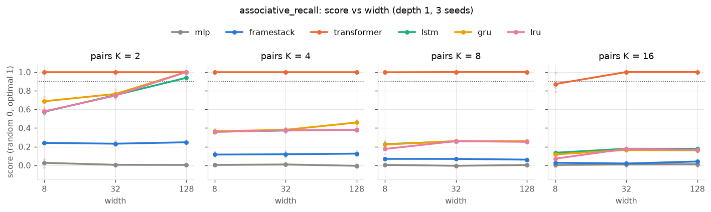
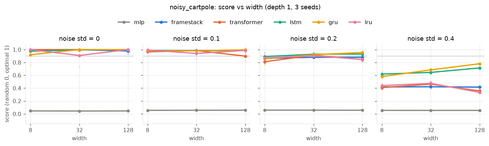
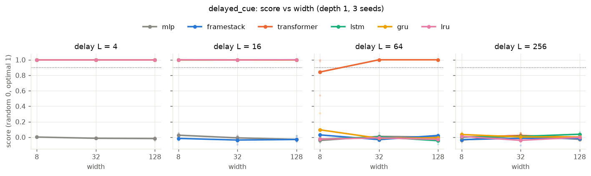
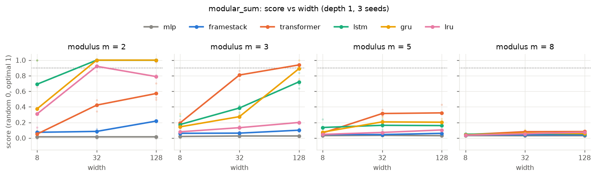
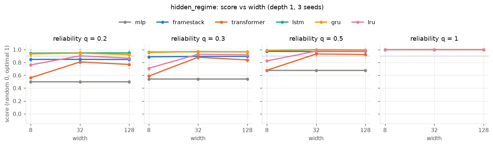
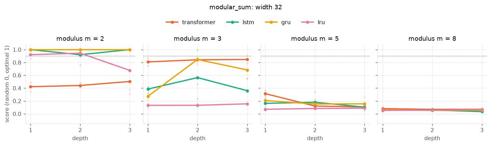

# Part 2 findings: memory size per kind of partial observability

Hardware: GTX 1080, JAX 0.12 (cuda12), Flax linen. Background, task definitions and plan:
[memory-background.md](memory-background.md). Generated tables and figures (regenerate with
`scripts/aggregate_memory.py`): [results/](results/) `m1_*`, `m2_*`, `m3_*`.

**Caveats.** 3 seeds per cell; one PPO configuration (tuned on GRU-64, then frozen) for every model;
5–8 M env steps per run; widths only {8, 32, 128}, so "smallest width" is resolved to a factor of 4.
A `>max` means *not reached within this budget with this optimiser*, not *impossible at this size*;
the supervised probe below shows the difference can be large. Scores are normalised so that random
play = 0 and optimal = 1. "Passes" means a mean score ≥ 0.9.

## TL;DR

1. **The kind of partial observability decides which architecture works; width mostly doesn't.**
   Most passing cells pass already at width 8, and most failing ones fail at every width. Width
   moves the result in only three places: noise level σ = 0.2 (8 → 32), modular counting
   (parity needs 32, mod 3 needs 128) and recurrent recall of 2 pairs (128).
2. **Recommended sizes** (depth 1, smallest width that passed, PPO at 5–8 M steps):

   | Kind of PO | Task, levels passed | Best choice | Size needed |
   |---|---|---|---|
   | Missing derivatives | CartPole, noise 0 | anything with memory (not MLP) | width 8 |
   | Observation noise | CartPole, noise ≤ 0.2 | LSTM / GRU / LRU / transformer | width 32; nothing passes 0.4 |
   | Hidden switching state | regime, q down to 0.2 | **LSTM / GRU** | **width 8** (LRU 32; transformer, frame stack fail at q ≤ 0.3) |
   | Delayed recall | cue, delay ≤ 16 (≤ 256 with enough reach) | transformer (context > L) or LRU (BPTT > L) | width 8; beyond that **reach, not width**: see M3 |
   | Capacity (K pairs) | recall, K ≤ 16 | **transformer** | width 8 to K=8, 32 for K=16 |
   | Computation (mod m) | running sum | LSTM / GRU / LRU for parity; mod 3 only transformer-128 (GRU-128 0.89, GRU 2 × 32 0.85) | nothing passes m ≥ 5 |

3. **Capacity: the recurrent plateau is optimisation, not size.** Under PPO, LSTM/GRU/LRU stall at
   about 1.5–3 stored pairs at *every* width (8–128). The same GRU-128 trained with supervised
   labels and full BPTT for 30 k steps recalls 8 pairs perfectly (1.00), and the LRU-128 reaches 0.97
   at 4 pairs. A transformer gets there almost immediately at width 8 because retrieval by attention
   needs no learned write/erase scheme.
4. **Filtering favours gated RNNs.** On `hidden_regime`, a GRU or LSTM of width 8 (a few hundred
   parameters) tracks the Bayes filter within 5–7 % even when only 20 % of observations are truthful;
   the transformer at 400 k parameters does worse (0.77–0.81). Accumulating evidence is what a gated
   recurrence does natively; attention has to re-average its window every step.
5. **Long delays need gradient reach, not width** (M3). The transformer remembers exactly its
   context (C = 256 solves L = 256); with BPTT 256 the LRU solves L = 64, while GRU/LSTM reach only
   0.44–0.66. **Depth helps computation, not capacity** (M2): GRU 2 × 32 matches 1 × 128 on mod 3.
6. **Linear recurrence (LRU) is fast but not free**: 2–3× the throughput of LSTM/GRU at the same
   width, equal on short recall, derivatives and parity, but it needs 4× the width on the regime
   filter and is the weakest on mod 3 (0.20 vs 0.89 for GRU-128), as the theory of time-invariant
   linear recurrences predicts.

---

## M1: width needed per task and level

Summary of the smallest passing width (full scores per task in `results/m1_width_<task>.md`;
the summary table with core-parameter counts is [results/m1_summary.md](results/m1_summary.md)):

| model | cartpole σ 0 / 0.1 / 0.2 / 0.4 | cue L 4 / 16 / 64 / 256 | recall K 2 / 4 / 8 / 16 | mod m 2 / 3 / 5 / 8 | regime q 1 / 0.5 / 0.3 / 0.2 |
|---|---|---|---|---|---|
| mlp | – / – / – / – | – / – / – / – | – / – / – / – | – / – / – / – | 8 / – / – / – |
| framestack (8) | 8 / 8 / – / – | 8 / – / – / – | – / – / – / – | – / – / – / – | 8 / 8 / – / – |
| transformer (C 64) | 8 / 8 / 32 / – | 8 / 8 / 32 / – | 8 / 8 / 8 / 32 | – / 128 / – / – | 8 / 32 / – / – |
| lstm | 8 / 8 / 32 / – | 8 / 8 / – / – | 128 / – / – / – | 32 / – / – / – | 8 / 8 / 8 / 8 |
| gru | 8 / 8 / 32 / – | 8 / 8 / – / – | 128 / – / – / – | 32 / – / – / – | 8 / 8 / 8 / 8 |
| lru | 8 / 8 / 32 / – | 8 / 8 / – / – | 128 / – / – / – | 32 / – / – / – | 8 / 32 / 32 / 32 |

(– = no width up to 128 passed.) Parameter counts of the cores at width 8 / 32 / 128: GRU 272 / 3.4 k /
50 k, LSTM 352 / 4.5 k / 67 k, LRU 488 / 6.6 k / 100 k, transformer 1.8 k / 25 k / 396 k.

### Missing derivatives and noise (`noisy_cartpole`)

* Without noise the MLP fails (0.05: it sees positions only), and **every memory model including an
  8-frame stack solves it at width 8**: two frames are enough to difference.
* With noise σ = 0.2 the frame stack plateaus at 0.86–0.88 regardless of width (8 frames are not
  enough to average out the noise), while the recurrent models and the transformer need width 32.
* At σ = 0.4 nothing passes; LSTM/GRU degrade most gracefully and are the only models that still gain
  with width (GRU 0.58 → 0.68 → 0.78). The "optimum" here is the noiseless 500 steps, which is probably
  not reachable, so the true gap is smaller than the score suggests.

### Delayed recall (`delayed_cue`)

* A clean step function that **width does not move**. Every recurrent core is perfect at L ≤ 16 and
  at chance at L ≥ 64, at every width. The frame stack (8 frames) is perfect at L = 4 and at chance after.
  The transformer (context 64) solves L = 64 from width 32 and is at chance at L = 256.
* The common cutoff is the **gradient reach**: training sequences are 64 steps long and are cut at
  rollout boundaries, not at episode starts, so a cue 64 steps back is almost never in the same
  sequence as its query. The recurrent state *can* carry it (the carry flows across chunks), but no
  gradient ever teaches it to. The transformer reaches back through its stored per-layer memory for
  exactly its context length and no further. M3 varies this reach directly.

### Capacity (`associative_recall`)

* The transformer passes every level at width 8 except K = 16 (0.87), which needs width 32.
* LSTM/GRU/LRU need width 128 even for K = 2, and at K ≥ 4 they plateau at a score of about 0.38 /
  0.26 / 0.17 (K = 4 / 8 / 16) **identical at widths 8, 32 and 128**. Converted, that is about 1.5,
  2 and 2.7 pairs answered above chance. The training curves are flat for the last 30 % of training.
* A plateau independent of width means the limit is not capacity. See the supervised probe below.

### Computation over the history (`modular_sum`)

* Parity (m = 2) needs width 32 for LSTM, GRU and LRU (width 8 succeeds on some seeds only: 0.37 ±
  0.54 for GRU).
* Mod 3 is solved only by GRU-128 (0.89, just under the line) and the transformer-128 (0.94); m ≥ 5 is
  out of reach for everything in this budget (best 0.32).
* The LRU stays at 0.20 on mod 3 at width 128. Its recurrence is linear and input-independent
  (h ← λ ⊙ h + B x), so it cannot implement the input-dependent state transition "add d mod m" exactly
  (Merrill et al. 2024); a single layer has to approximate it with the nonlinearity after the
  recurrence, which drifts over 32 steps.
* The transformer is odd: it does better on mod 3 than on parity. It has to recompute the whole
  sum by attending to every past digit each step; why that suits m = 3 is not clear from these runs.

### Hidden switching state (`hidden_regime`)

* **LSTM and GRU at width 8 pass every level**, down to q = 0.2 (0.93–0.95 of the Bayes filter).
* The LRU needs width 32 (0.90–0.98); at width 8 it reaches only 0.71–0.82.
* The 8-frame stack is surprisingly good (0.85–0.97): with a 5 % switch rate, the last 8 observations
  hold most of the evidence.
* The transformer is the weakest memory model here (0.77–0.84 at q ≤ 0.3, even at width 128) and
  its curves are still rising, so it may be slower rather than worse.

### Throughput

k env steps/s, 12 runs `vmap`-ped (associative recall):

| model | w8 | w32 | w128 |
|---|---:|---:|---:|
| mlp | 3282 | 3020 | 2168 |
| framestack | 1896 | 1816 | 1432 |
| lru | 1887 | 1130 | 397 |
| lstm | 732 | 626 | 194 |
| gru | 598 | 493 | 196 |
| transformer | 824 | 386 | 105 |

## Capacity or optimisation? Supervised recall probe

`scripts/bench/recall_supervised.py` trains the same `ActorCritic` on the same observation stream by
cross-entropy on the correct answer at each query step, with full backpropagation through the whole
episode (no truncation, no RL). Normalised the same way as M1.

3 k steps, batch 256 (CPU):

| core | width | K=2 | K=4 | K=8 | K=16 |
|---|---|---|---|---|---|
| gru | 8 | 0.50 | 0.38 | 0.26 | 0.18 |
| gru | 32 | 0.94 | 0.37 | 0.26 | 0.18 |
| gru | 128 | 1.00 | 0.50 | 0.26 | 0.18 |
| lstm | 8 | 0.50 | 0.37 | 0.26 | 0.13 |
| lstm | 32 | 0.94 | 0.38 | 0.26 | 0.18 |
| lstm | 128 | 0.98 | 0.46 | 0.26 | 0.18 |
| lru | 8 | 0.74 | 0.48 | 0.26 | 0.14 |
| lru | 32 | 1.00 | 0.82 | 0.25 | 0.18 |
| lru | 128 | 1.00 | 0.92 | 0.45 | 0.18 |
| transformer | 8–128 | 1.00 | 1.00 | 1.00 | 1.00 |

30 k steps, width 128:

| core | K=4 | K=8 |
|---|---|---|
| gru | 1.00 | 1.00 |
| lru | 0.97 | 0.62 |

* After 3 k supervised steps the GRU and LSTM sit on **exactly the PPO plateau** (0.38 / 0.26 / 0.18),
  so the plateau is not caused by the RL signal: it is a saddle the optimiser has to escape. Given 10×
  longer, GRU-128 escapes it and recalls 8 pairs perfectly. Width 128 was enough capacity all along.
* The LRU escapes sooner and scales with width earlier (0.48 → 0.82 → 0.92 at K = 4), but at 30 k steps
  is behind the GRU at K = 8.
* The transformer solves every K at every width in 3 k steps: attention implements key-matching
  retrieval directly, while a recurrent net has to discover a distributed write/erase code.
* **Practical reading:** for capacity-type memory, "how wide" has a cheap answer (K × bits is far
  below width 128), and the real cost is samples. A transformer converts that cost into parameters
  and compute; a recurrent net pays it in training time.

## M2: does depth substitute for width?

Depth 1–3 at width 32, where M1 showed recurrent cores short of the target (full table:
[results/m2_depth.md](results/m2_depth.md)).

* **Computation: yes, depth helps, and is cheaper than width.** GRU w32 at depth 2 reaches 0.85 on
  mod 3 (depth 1: 0.27), about what GRU w128 at depth 1 gets (0.89) with roughly 7 k instead of 50 k core
  parameters. LSTM gains less and noisily (0.39 → 0.56 ± 0.39). Depth 3 is worse than 2 for every
  recurrent core at this budget (deeper stacks train more slowly). m ≥ 5 stays out of reach.
* **The LRU does not benefit on mod 3** (0.13 / 0.13 / 0.16): stacking linear recurrences with
  nonlinearities between them does not supply the input-dependent state transition that the task
  needs, consistent with the theory.
* **The transformer is flat in depth** (mod 3: 0.81 / 0.84 / 0.85) and loses ground on m = 5.
* **Capacity: no.** On recall, depth leaves the 0.37 / 0.26 / 0.18 plateau at K ≥ 4 untouched for
  every recurrent core. The only change is the LRU at K = 2, which goes from 0.75 to 1.00 at depth 2
  (what width 128 achieved at depth 1). This fits the optimisation reading of the plateau:
  more parameters in any arrangement do not help, more training does.

## M3: delayed recall, gradient reach vs memory length

`delayed_cue` at width 64 with `n_steps` = 256 (so a 256-step training sequence spans the whole
rollout). Reach = truncated-BPTT length for recurrent cores, attention context for the transformer
(table: [results/m3_delay.md](results/m3_delay.md)).

| model | reach 16 | reach 64 | reach 256 |
|---|---|---|---|
| transformer (context) | L ≤ 16 | L ≤ 64 | **L ≤ 256** (1.00) |
| lstm (BPTT) | L ≤ 16 | L ≤ 16 (L=64: 0.40) | L ≤ 16 (L=64: 0.44) |
| gru (BPTT) | L ≤ 16 | L ≤ 16 (L=64: 0.40) | L ≤ 16 (L=64: 0.66) |
| lru (BPTT) | L ≤ 16 | L ≤ 16 | **L ≤ 64** (1.00) |

(largest delay passed, with the partial score at the next level.)

* **The transformer's memory length is its context, exactly.** Context C solves every L < C and fails
  at chance beyond: a hard, predictable cutoff, independent of width (M1).
* **For recurrent nets the BPTT length is necessary but not sufficient.** With reach 16, nothing goes
  past L = 16. Increasing it to 256 makes L = 64 solvable *in principle*, but only the LRU actually
  learns it (1.00); LSTM and GRU end at 0.44 and 0.66. The LRU's eigenvalues start near the unit circle
  (|λ| ∈ [0.9, 0.999]), so a signal and its gradient survive 64 steps from initialisation; a gated RNN
  first has to learn to close its forget gate. This is the long-memory regime that SSMs were designed
  for.
* **L = 256 is unreachable for every recurrent core here** for a structural reason: the episode is
  257 steps and the rollout 256, so no training sequence ever contains both the cue and its query.
  Truncated BPTT over rollouts cannot learn a dependency longer than the rollout; the transformer
  succeeds only because its memory (no gradient) lets the query attend to the cue stored before
  the chunk, while the gradient to the attention weights comes from the query side alone.
* Rule of thumb: **memory length L needs a BPTT window (or context) of more than L, plus a rollout
  longer than L**, and with a gated RNN still expect to fall short beyond about 32 steps at this
  budget.

## Recommendations

How large a memory model to use, by kind of partial observability (depth 1 unless stated; PPO,
5–8 M steps; widths resolved to a factor of 4):

| Kind | What to use | Size | What actually limits it |
|---|---|---|---|
| Missing derivatives | frame stack (2–8 frames) or any RNN | width 8 | nothing; don't overpay |
| Observation noise | GRU / LSTM | width 32 at moderate noise, more width still helps at high noise | how many readings the state can average |
| Hidden switching state (belief) | **GRU / LSTM** | **width 8** for 4 regimes; LRU needs 32 | update type: gated recurrence is a natural filter |
| Delayed recall, length L | **transformer with context > L**, or **LRU with BPTT > L** | any width (8 is enough) | gradient reach: BPTT length, rollout length, context |
| Capacity, K items | **transformer** | width 8 to K = 8, 32 for K = 16 | for RNNs: training time, not width (GRU-128 holds 8 pairs given enough training) |
| Nonlinear computation (counting mod m) | GRU / LSTM, **deeper rather than wider** | parity: width 32; mod 3: width 32 × depth 2 or width 128 | optimisation; LRU and transformer are poorly suited |

General points:

1. **Pick the architecture for the kind of memory first; width second.** The gap between the right
   and the wrong architecture (e.g. transformer vs GRU on recall, GRU vs transformer on belief
   tracking) is much larger than anything width bought within 8–128.
2. **Width is cheap to over-provision, not to under-provision**, but past the threshold it buys
   little and costs throughput (GRU 4× slower from width 8 to 128, transformer 8×).
3. **Depth is worth trying for computation-type memory** (GRU 2 × 32 matched 1 × 128 with 7× fewer
   parameters) and is useless for capacity or delay.
4. **For long memory, set `seq_len` and `n_steps` from the dependency length** before anything else;
   a model can't learn a dependency its training sequences never contain.
5. **A plateau that does not move with width is an optimisation plateau.** Train longer, use
   a different architecture, or (for diagnosis) a supervised probe as in
   `scripts/bench/recall_supervised.py`.

### Not tested here (next steps)

* Longer budgets (≥ 50 M steps) for the recurrent recall and mod-m cells. The supervised probe
  suggests several `>max` cells would pass.
* Input-dependent (selective) SSMs such as Mamba-style gating, which should combine the LRU's long
  reach with the state-tracking that the plain LRU lacks.
* Credit-assignment length (reward delayed from the action that used the memory), kept at zero here.
* Per-architecture PPO tuning, especially the transformer's lr and the LRU's eigenvalue ring.
