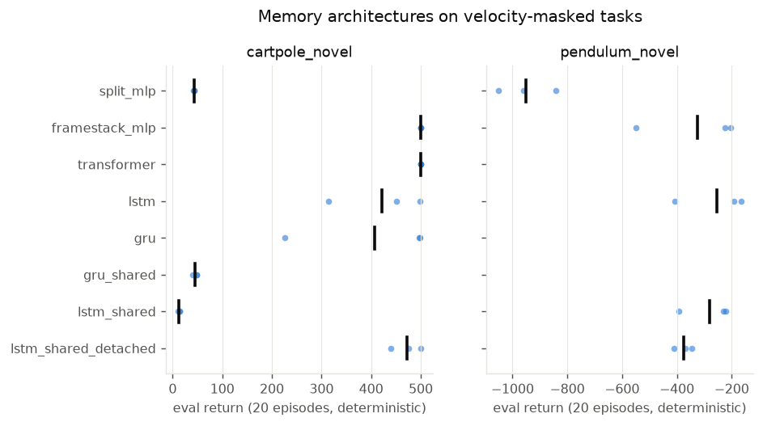
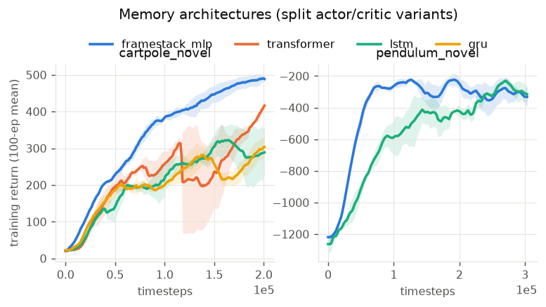

<!-- generated by scripts/aggregate.py; do not edit -->
# e2_memory

| env            | model                |   seeds | final eval     | mean train return (AUC)   | wall s       | params         |
|:---------------|:---------------------|--------:|:---------------|:--------------------------|:-------------|:---------------|
| cartpole_novel | framestack_mlp       |       3 | 500.0 ± 0.0    | 332.2 ± 12.0              | 50.6 ± 0.9   | 10691.0 ± 0.0  |
| cartpole_novel | gru                  |       3 | 407.0 ± 156.9  | 197.6 ± 13.4              | 159.2 ± 0.9  | 34627.0 ± 0.0  |
| cartpole_novel | gru_shared           |       3 | 45.6 ± 5.4     | 30.3 ± 7.7                | 210.5 ± 23.9 | 21571.0 ± 0.0  |
| cartpole_novel | lstm                 |       3 | 421.0 ± 95.9   | 207.6 ± 16.6              | 131.3 ± 5.5  | 43331.0 ± 0.0  |
| cartpole_novel | lstm_shared          |       3 | 12.9 ± 1.4     | 22.0 ± 0.2                | 110.9 ± 3.5  | 25923.0 ± 0.0  |
| cartpole_novel | lstm_shared_detached |       3 | 471.7 ± 30.0   | 223.9 ± 28.7              | 96.4 ± 1.3   | 25923.0 ± 0.0  |
| cartpole_novel | split_mlp            |       3 | 42.7 ± 1.0     | 47.6 ± 0.4                | 50.3 ± 0.7   | 8899.0 ± 0.0   |
| cartpole_novel | transformer          |       3 | 500.0 ± 0.0    | 220.0 ± 27.6              | 258.9 ± 6.0  | 144067.0 ± 0.0 |
| pendulum_novel | framestack_mlp       |       3 | -326.1 ± 194.0 | -399.1 ± 35.6             | 222.4 ± 7.8  | 10690.0 ± 0.0  |
| pendulum_novel | lstm                 |       3 | -255.1 ± 132.1 | -569.9 ± 31.3             | 383.6 ± 42.2 | 43330.0 ± 0.0  |
| pendulum_novel | lstm_shared          |       3 | -281.3 ± 95.4  | -617.3 ± 38.2             | 265.3 ± 59.3 | 25922.0 ± 0.0  |
| pendulum_novel | lstm_shared_detached |       3 | -375.0 ± 33.3  | -750.5 ± 175.6            | 227.2 ± 21.9 | 25922.0 ± 0.0  |
| pendulum_novel | split_mlp            |       3 | -951.4 ± 104.9 | -1104.4 ± 5.9             | 223.9 ± 4.7  | 8898.0 ± 0.0   |
