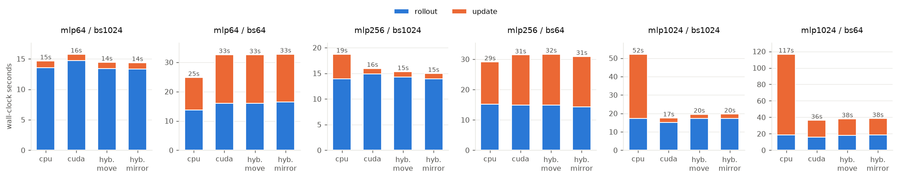

<!-- generated by scripts/aggregate.py; do not edit -->
# e3_device_mlp

| case             | device        |   wall_time |   rollout_time |   train_time |   transfer_time |    fps |   eval_mean |
|:-----------------|:--------------|------------:|---------------:|-------------:|----------------:|-------:|------------:|
| mlp1024 / bs1024 | cpu           |        52.2 |           17.2 |         34.9 |             0   | 2199   |       -71.3 |
| mlp1024 / bs1024 | cuda          |        17.5 |           15.2 |          2.3 |             0   | 6552   |       -97.8 |
| mlp1024 / bs1024 | hybrid_mirror |        19.6 |           17.3 |          2.3 |             0   | 5848.6 |       -87.2 |
| mlp1024 / bs1024 | hybrid_move   |        19.5 |           17.2 |          2.3 |             0.1 | 5876.5 |       -87.2 |
| mlp1024 / bs64   | cpu           |       116.7 |           18.8 |         97.9 |             0   |  982.8 |      -158.1 |
| mlp1024 / bs64   | cuda          |        36.4 |           16.1 |         20.2 |             0   | 3154.5 |       -49.9 |
| mlp1024 / bs64   | hybrid_mirror |        38.4 |           18.5 |         19.9 |             0   | 2985   |      -111.6 |
| mlp1024 / bs64   | hybrid_move   |        38.1 |           18.1 |         20   |             0.1 | 3010.4 |      -111.6 |
| mlp256 / bs1024  | cpu           |        18.7 |           13.9 |          4.8 |             0   | 6121.8 |     -1044.8 |
| mlp256 / bs1024  | cuda          |        16   |           14.9 |          1.1 |             0   | 7184.6 |       -15.1 |
| mlp256 / bs1024  | hybrid_mirror |        15   |           13.9 |          1.1 |             0   | 7660.3 |     -1044.8 |
| mlp256 / bs1024  | hybrid_move   |        15.3 |           14.2 |          1.1 |             0   | 7488.1 |     -1044.8 |
| mlp256 / bs64    | cpu           |        29.1 |           15.2 |         13.9 |             0   | 3939.8 |      -113.9 |
| mlp256 / bs64    | cuda          |        31.4 |           14.8 |         16.6 |             0   | 3652.7 |       -19.2 |
| mlp256 / bs64    | hybrid_mirror |        30.9 |           14.3 |         16.6 |             0   | 3709   |       -59   |
| mlp256 / bs64    | hybrid_move   |        31.7 |           14.9 |         16.7 |             0   | 3621.5 |       -59   |
| mlp64 / bs1024   | cpu           |        14.7 |           13.6 |          1.1 |             0   | 7823.4 |      -718.9 |
| mlp64 / bs1024   | cuda          |        15.8 |           14.7 |          1   |             0   | 7270.7 |       158.1 |
| mlp64 / bs1024   | hybrid_mirror |        14.4 |           13.3 |          1.1 |             0   | 7972.6 |      -718.9 |
| mlp64 / bs1024   | hybrid_move   |        14.4 |           13.4 |          1.1 |             0   | 7939.8 |      -718.9 |
| mlp64 / bs64     | cpu           |        24.8 |           13.7 |         11.1 |             0   | 4619.6 |      -162.8 |
| mlp64 / bs64     | cuda          |        32.6 |           16   |         16.6 |             0   | 3516.8 |      -181.6 |
| mlp64 / bs64     | hybrid_mirror |        32.8 |           16.4 |         16.3 |             0   | 3499.2 |      -174.5 |
| mlp64 / bs64     | hybrid_move   |        32.5 |           16   |         16.5 |             0   | 3526.4 |      -174.5 |
