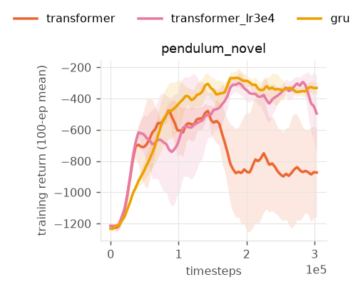

<!-- generated by scripts/aggregate.py; do not edit -->
# e5_transformer_lr

| env            | model             |   seeds | final eval     | mean train return (AUC)   |
|:---------------|:------------------|--------:|:---------------|:--------------------------|
| pendulum_novel | gru               |       3 | -234.4 ± 88.3  | -506.5 ± 56.3             |
| pendulum_novel | transformer       |       3 | -854.7 ± 10.6  | -758.1 ± 164.1            |
| pendulum_novel | transformer_lr3e4 |       3 | -578.3 ± 322.0 | -551.1 ± 157.2            |
