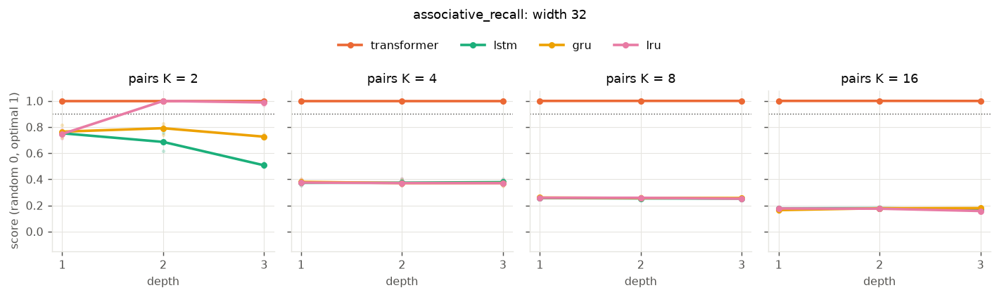

# M2: depth vs width

Score: mean ± std over 3 seeds.

## associative_recall, width 32

|                           | 2           | 4           | 8           | 16          |
|:--------------------------|:------------|:------------|:------------|:------------|
| ('transformer', 'w32 d1') | 1.00 ± 0.00 | 1.00 ± 0.00 | 1.00 ± 0.00 | 1.00 ± 0.00 |
| ('transformer', 'w32 d2') | 1.00 ± 0.00 | 1.00 ± 0.00 | 1.00 ± 0.00 | 1.00 ± 0.00 |
| ('transformer', 'w32 d3') | 1.00 ± 0.00 | 1.00 ± 0.00 | 1.00 ± 0.00 | 1.00 ± 0.00 |
| ('lstm', 'w32 d1')        | 0.75 ± 0.01 | 0.37 ± 0.02 | 0.26 ± 0.01 | 0.18 ± 0.00 |
| ('lstm', 'w32 d2')        | 0.69 ± 0.07 | 0.37 ± 0.02 | 0.25 ± 0.01 | 0.18 ± 0.01 |
| ('lstm', 'w32 d3')        | 0.51 ± 0.02 | 0.38 ± 0.02 | 0.25 ± 0.01 | 0.17 ± 0.01 |
| ('gru', 'w32 d1')         | 0.76 ± 0.05 | 0.38 ± 0.02 | 0.26 ± 0.01 | 0.16 ± 0.02 |
| ('gru', 'w32 d2')         | 0.79 ± 0.05 | 0.37 ± 0.02 | 0.26 ± 0.02 | 0.18 ± 0.01 |
| ('gru', 'w32 d3')         | 0.73 ± 0.02 | 0.37 ± 0.02 | 0.26 ± 0.01 | 0.18 ± 0.01 |
| ('lru', 'w32 d1')         | 0.75 ± 0.03 | 0.38 ± 0.02 | 0.26 ± 0.01 | 0.18 ± 0.01 |
| ('lru', 'w32 d2')         | 1.00 ± 0.00 | 0.37 ± 0.03 | 0.26 ± 0.01 | 0.17 ± 0.01 |
| ('lru', 'w32 d3')         | 0.99 ± 0.02 | 0.37 ± 0.02 | 0.25 ± 0.01 | 0.16 ± 0.00 |

## modular_sum, width 32

|                           | 2           | 3           | 5           | 8           |
|:--------------------------|:------------|:------------|:------------|:------------|
| ('transformer', 'w32 d1') | 0.42 ± 0.07 | 0.81 ± 0.06 | 0.31 ± 0.04 | 0.08 ± 0.01 |
| ('transformer', 'w32 d2') | 0.44 ± 0.04 | 0.84 ± 0.01 | 0.12 ± 0.01 | 0.07 ± 0.00 |
| ('transformer', 'w32 d3') | 0.50 ± 0.19 | 0.85 ± 0.06 | 0.11 ± 0.01 | 0.07 ± 0.01 |
| ('lstm', 'w32 d1')        | 1.00 ± 0.00 | 0.39 ± 0.05 | 0.16 ± 0.07 | 0.06 ± 0.01 |
| ('lstm', 'w32 d2')        | 0.92 ± 0.14 | 0.56 ± 0.39 | 0.18 ± 0.14 | 0.06 ± 0.01 |
| ('lstm', 'w32 d3')        | 1.00 ± 0.00 | 0.36 ± 0.19 | 0.10 ± 0.06 | 0.03 ± 0.01 |
| ('gru', 'w32 d1')         | 1.00 ± 0.00 | 0.27 ± 0.05 | 0.21 ± 0.05 | 0.06 ± 0.04 |
| ('gru', 'w32 d2')         | 1.00 ± 0.00 | 0.85 ± 0.06 | 0.15 ± 0.07 | 0.05 ± 0.01 |
| ('gru', 'w32 d3')         | 1.00 ± 0.00 | 0.68 ± 0.15 | 0.16 ± 0.09 | 0.06 ± 0.00 |
| ('lru', 'w32 d1')         | 0.92 ± 0.06 | 0.13 ± 0.04 | 0.07 ± 0.01 | 0.05 ± 0.00 |
| ('lru', 'w32 d2')         | 0.94 ± 0.05 | 0.13 ± 0.02 | 0.08 ± 0.01 | 0.06 ± 0.00 |
| ('lru', 'w32 d3')         | 0.68 ± 0.31 | 0.16 ± 0.00 | 0.09 ± 0.01 | 0.07 ± 0.01 |
