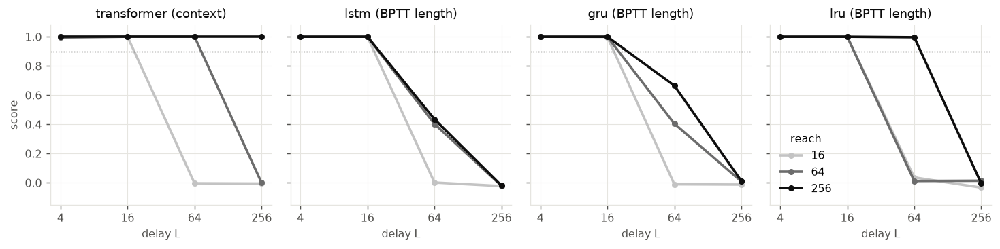

# M3: delayed recall vs gradient reach

Reach = truncated-BPTT length (`seq_len`) for recurrent cores, attention context for the transformer (its BPTT length is fixed at the default). Width 64, depth 1, mean of 3 seeds.

|                      |    4 |   16 |    64 |   256 |
|:---------------------|-----:|-----:|------:|------:|
| ('transformer', 16)  | 1    |    1 | -0    | -0.01 |
| ('transformer', 64)  | 0.99 |    1 |  1    |  0    |
| ('transformer', 256) | 1    |    1 |  1    |  1    |
| ('lstm', 16)         | 1    |    1 |  0    | -0.02 |
| ('lstm', 64)         | 1    |    1 |  0.4  | -0.02 |
| ('lstm', 256)        | 1    |    1 |  0.44 | -0.02 |
| ('gru', 16)          | 1    |    1 | -0.01 | -0.01 |
| ('gru', 64)          | 1    |    1 |  0.4  |  0.01 |
| ('gru', 256)         | 1    |    1 |  0.66 |  0.01 |
| ('lru', 16)          | 1    |    1 |  0.04 | -0.03 |
| ('lru', 64)          | 1    |    1 |  0.01 |  0.01 |
| ('lru', 256)         | 1    |    1 |  1    | -0.01 |
